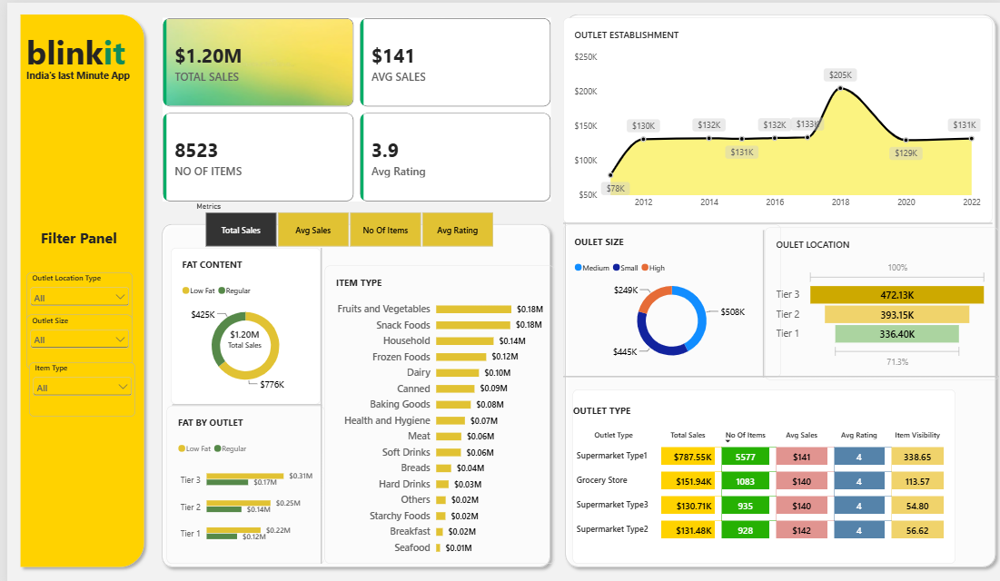

# BlinkIT Grocery Sales Dashboard (Power BI)

An interactive Power BI dashboard that analyses BlinkIT grocery sales across products, outlets and locations. It tracks four core metrics and lets users switch between them to explore how sales and ratings vary by item type, fat content, outlet size, location tier, outlet type and establishment year.

## Key Metrics

| Metric | Value |
|---|---|
| Total Sales | $1.20M |
| Average Sales | $141 |
| Number of Items | 8,523 |
| Average Rating | 3.9 |

## Dashboard Features

- **KPI cards** for Total Sales, Average Sales, Number of Items and Average Rating
- **Metric selector** to switch the charts between Total Sales, Avg Sales, No of Items and Avg Rating
- **Filter panel** with dropdown slicers for Outlet Location Type, Outlet Size and Item Type
- **Fat Content** donut chart and **Fat by Outlet** bar chart, split by location tier
- **Item Type** bar chart ranking product categories
- **Outlet Size** donut chart and **Outlet Location** funnel chart
- **Outlet Establishment** line chart showing sales by establishment year
- **Outlet Type** table with conditional formatting across Total Sales, No of Items, Avg Sales, Avg Rating and Item Visibility
- Cross-filtering between visuals for interactive exploration

## Insights from the Dashboard

- **Fat content:** Low Fat items account for about $776K of sales, compared with about $425K for Regular items.
- **Item type:** Fruits and Vegetables and Snack Foods are the top categories at about $0.18M each, followed by Household at $0.14M.
- **Outlet type:** Supermarket Type1 generates $787.55K, roughly two-thirds of total sales, and carries 5,577 of the 8,523 items.
- **Outlet size:** Medium outlets lead with $508K, followed by Small ($445K) and High ($249K).
- **Location tier:** Tier 3 outlets lead at $472.13K, ahead of Tier 2 ($393.15K) and Tier 1 ($336.40K).
- **Establishment year:** Sales peak at $205K for outlets established in 2018.
- **Average sales and ratings:** Average sales per item is nearly identical across outlet types ($140 to $142), and average rating is about 4 for all of them.

## Tools Used

- Power BI Desktop
- DAX measures (Total Sales, Avg Sales, No Of Items, Avg Rating)

## Dataset

BlinkIT Grocery Data: 8,523 item-level records covering item type, fat content, item visibility, outlet size, outlet location type, outlet type, outlet establishment year, sales and rating.

## Repository Structure

```
├── BLINKIT_P1.pbix    # Power BI report
├── dashboard.png      # Dashboard screenshot
└── README.md
```

## How to Use

1. Download `BLINKIT_P1.pbix`.
2. Open it in Power BI Desktop.
3. Use the filter panel and the metric selector to explore the data.

## Author

Prerna
